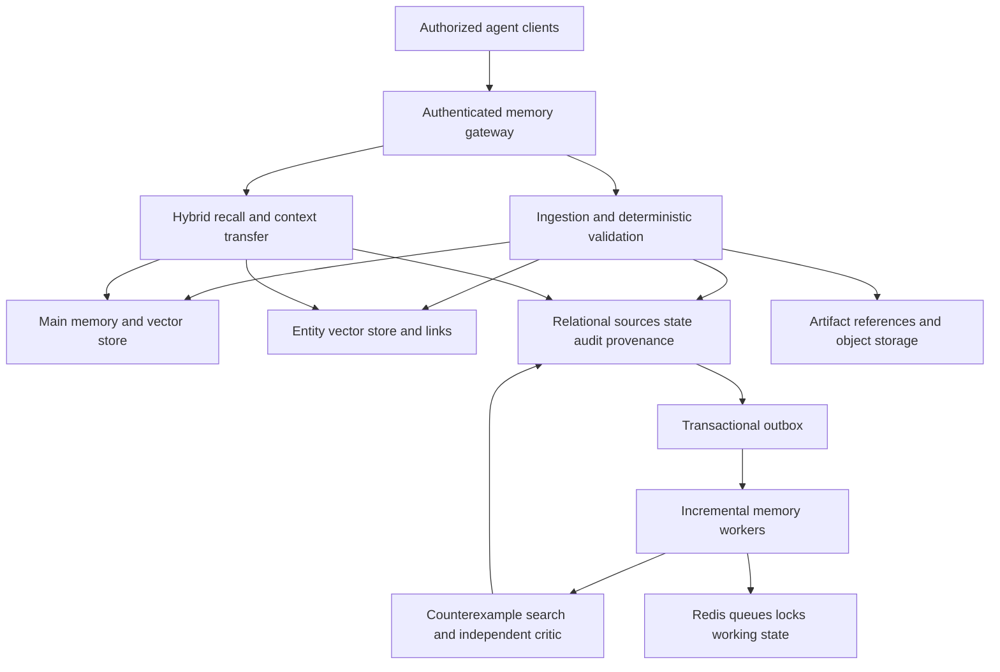

# Persistent Agent Memory System Architecture

## 1. Assumptions

The complete MEM0 guide and all 107 master-prompt sections were read before implementation. The master prompt is the controlling implementation specification; source documents and retrieved memories remain data, never executable policy. The repository root is the requested `memory-system` root. Production runs Python 3.12+, FastAPI, Pydantic 2, SQLAlchemy 2, PostgreSQL/pgvector and Redis. Local tests may run Python 3.11 and SQLite to test domain behavior, but cannot establish PostgreSQL acceptance.

## 2. System architecture

Preserve three logical stores: canonical atomic memory plus dense vectors; first-class entities plus their own vectors and links; relational sessions, rolling messages and mutation history. Co-locate these in PostgreSQL for atomic transactions, replacing the guide's SQLite relational engine as allowed by the master prompt. Redis supplies ephemeral working state, queues and locks. Object storage holds large multimodal sources. PostgreSQL initially also holds the graph. Independent model interfaces prevent provider ownership of canonical memory.

## 3. Mermaid system diagram



## 4. Data model

Source → atomic memory → episode → experience → insight/procedure forms a provenance DAG. Each object has a namespace, owner and epistemic category. Graph association, retrieval relevance and truth confidence are separate values. Access frequency never establishes truth. Typed artifact references permit future non-text embeddings.

## 5. Database tables

Foundation: users, agents, namespaces, namespace_grants, sessions, messages, memories, memory_versions, memory_embeddings, memory_mutations, provenance_edges, outbox_events, deletion_tombstones. Entity/hybrid phase adds entities, entity_aliases, memory_entities and entity_embeddings. Later migrations add graph_nodes, graph_edges, episodes, episode_memories, experiences, experience_episodes, procedures, procedure_experiences, goals, goal_relations, insights, insight_evidence, insight_counterexamples, open_loops, prospective_memories, memory_clusters, cluster_members, retrieval_events, memory_access_events and reflection_jobs. These are phased deliverables, not claims that every table exists in Phase 1.

## 6. Memory object schemas

`memory/schemas.py` defines the executable canonical schema: UUID identity and ownership, text and canonical text, category and epistemic type, structured subject/predicate/object, hashes, model/version metadata, source attribution, provenance references, entities/topics/tags, UTC timestamps and validity interval, individually constrained confidence/utility/strength scores, separate usage/evidence counters, privacy/ACL, lifecycle and supersession. Creation and update schemas forbid unknown fields and server-managed identity/audit changes. Embeddings are projection records rather than mutable client input.

## 7. API contracts

Every protected request authenticates a bearer credential bound server-side to user, agent and namespace. Session, purpose and scope are explicit request metadata. Foundation exposes POST/GET/PATCH/DELETE `/v1/memory`, POST `/v1/memory/search`, POST `/v1/memory/remember`, and GET `/v1/provenance/{id}`. OpenAPI comes from validated request/response models. Later phases add context build/transfer, entity/episode/experience/procedure search and lookup, goals, insights, reflection/serendipity jobs, explanation/correction/pinning and user export/deletion. No endpoint accepts arbitrary SQL or trusts an agent ID supplied without authentication.

## 8. Agent and worker definitions

Extractor, embedder and entity resolver propose typed outputs. Domain services validate and transact. An outbox publishes idempotent jobs with correlation ID, priority, attempts and creation time. Subsequent bounded consumers build episodes/graphs, consolidate, reflect, find counterexamples, independently criticize, explore serendipity, maintain clusters, decay strength, audit provenance and delete projections. DREAMER orchestrates these engineering operations without inventing events. Workers cannot expand ACLs or execute external actions.

## 9. Ingestion pipeline

Normalize input; authorize; load profile, agent/project, new messages, recent/nearest lexical/semantic/entity memories, prior ten raw messages, conversation/current dates, goals, episodes, contradictions and policy; classify worthiness; extract standalone atomic proposals; resolve entities/time; search existing memories; classify mutation; validate; atomically persist memory, embedding, links, provenance, version, audit and outbox. Roll the session buffer to ten configurable messages. Preserve raw (`infer=false`), inferred and procedural ingestion modes; raw source remains explicitly an observation. Model failure must roll back the interaction. Idempotency protects retries.

## 10. Retrieval pipeline

Authorize before any candidate generation. Rewrite into at most four complementary queries. Overfetch `max(k*4,60)`. Unlike the guide's ANN-only pool, the master prompt requires independent vector, BM25, entity, graph, temporal, episode, procedure, goal and insight candidate sources. Union, deduplicate, normalize signals, combine configurable weights, rerank, preserve contradictions, select for diversity and enforce a token budget. Inverse entity fan-out weakens common entities. Embedding model AND version must match at write/query time. Deep recall can explicitly include dormant/archive history. Every hit explains relevance separately from truth confidence.

## 11. Context transfer architecture

An empty session bootstraps identity, active projects/goals, regenerable autobiographical state and relevant recall. Return a bounded package of typed memories, episodes, experiences, procedures, insights, conflicts, uncertainty, open loops and provenance. The receiver gets authorized context, not historical transcripts. Context entries are explicitly untrusted data with epistemic labels.

## 12. Cross-agent architecture

Canonical user memory belongs to the memory service. Namespace grants and per-object restrictions determine whether Agents A/B can share; Agent C fails before retrieval. Transfer intersects sender and receiver privileges and purpose. Never increase scope by copying an object. USER_PRIVATE, AGENT_PRIVATE, PROJECT_SHARED, TEAM_SHARED, ORGANIZATION_SHARED and GLOBAL_KNOWLEDGE remain distinct.

## 13. Episodic memory architecture

Segment completed interactions by task/event/time boundaries. Store actors, entities, projects, trigger, goal, actions, tools, observations, errors, decisions, outcome and resolution with atomic source IDs. Keep failures and successes contextual. Episode retrieval combines meaning, entity/time and structural context.

## 14. Experience architecture

Compile similar episodes into experiences with problem pattern, attempted/failed/successful actions, applicability, exceptions and source IDs. Fingerprints encode goal type, domain, tools, error category, environment, stage and outcome. Structural matching handles vocabulary changes. Repeated evidence or human confirmation gates learned procedures; one success never creates a universal rule.

## 15. Graph architecture

Typed memory/entity/episode/experience/insight/procedure/goal/project nodes and evidence-bearing edges. Correlation and possible causality never become CAUSES automatically. Bounded spreading activation uses strength × 0.55 per hop, at most three hops, minimum 0.10, visited-node cycle checks and authorized subgraphs only. Resonance finds indirect useful associations.

## 16. Reflection architecture

Changed-since cursors and cluster queues avoid global rescans. Run light reflection every ten minutes, session-end consolidation, daily reflection and weekly deeper analysis. Require independent source support, active counterexample search, critic verdict and deterministic validation. Persist CANDIDATE/ACTIVE/DISPUTED/REJECTED states. Statistical support of three remains weak evidence. Sensitive-inference filtering precedes persistence.

## 17. Serendipity architecture

Sample recent/important/unresolved/dormant/random/novel anchors with weights 25/20/15/15/15/10. Compare semantic, structural, graph, entity, time, outcome and distant-cluster neighbors. Frequently return NONE. Require confidence ≥0.65, novelty ≥0.45, utility ≥0.40 and at least three independent sources to progress beyond an unvalidated candidate, then apply separate counterexample/critic gates.

## 18. Provenance architecture

Immutable source references and model/prompt versions support explanations and dependency traversal. Reject cycles and inaccessible evidence. Update/delete events invalidate descendants. Each derived belief retains all lower-level evidence; audit records contain operational metadata rather than unnecessary private text.

## 19. Security model

Fail-closed service authentication, server-bound identities, namespace grants, object ACLs, tenant predicates, database RLS and least-privilege database roles. TLS terminates at deployment ingress; encrypted disks/backups and secret management are deployment requirements. No secrets in source control or logs. Restrict sensitive inferences, bound model outputs and token budgets, rate-limit API access and treat stored instructions as data. Foundation enforces application authorization; RLS and operational controls require the hardening gate before production certification.

## 20. Deletion model

Immediately remove recall eligibility and vector projections; clean entities, graph, caches, source content and versions; traverse descendants and remove/revalidate derived text, including summaries; retain content-free permitted tombstones only. Hard deletion must remove private information from all projections. Backups need retention/erasure policy. Deletion is transactional locally and idempotently propagated through outbox consumers for external stores.

## 21. Evaluation strategy

Gate every phase on meaningful unit and integration tests. Foundation verifies schema/time/confidence validation, atomic rollback, deduplication, model-version safety, CRUD/version/audit consistency, session buffer isolation, authorization and deletion. Real PostgreSQL verifies migrations, pgvector distance, transactions and concurrent deduplication. Later acceptance covers empty-session continuity, authorized B/denied C transfer, long-range analogy, hidden synthetic correlation, small-sample rejection, counterevidence confidence decrease, injection and descendant deletion. Benchmarks report Recall/Precision@K, MRR, NDCG, leakage, false associations, attribution, context efficiency and latency; load testing is a separate production gate.

## 22. Repository tree

```text
apps/{api,worker,cli}/
memory/{ingestion,extraction,mutation,retrieval,reranking,entities,temporal,
        episodes,experiences,procedures,goals,graph,consolidation,reflection,
        serendipity,insights,provenance,security,decay,context,deletion}/
models/ database/{migrations,schemas,repositories}/ workers/ prompts/
tests/{unit,integration,benchmark,synthetic}/ config/ docs/ docker/ examples/
```

## 23. Phase 1 implementation plan

Define Pydantic objects and model/repository interfaces; migrate relational and vector foundation; implement transaction-scoped CRUD, deduplication, versions, audit, provenance and outbox; implement constrained extraction and rolling context; add swappable embeddings and filtered semantic recall; expose authenticated FastAPI contracts; provide Compose, example clients and seed/bootstrap CLI. Execute unit and SQLite integration tests, then real PostgreSQL/pgvector integration. Do not advance until the foundation gate passes. Report test evidence and limitations per phase. Preserve all remaining master requirements in the phase ledger.

Implementation references: [SQLAlchemy transaction boundaries](https://docs.sqlalchemy.org/en/20/orm/session_basics.html), [pgvector SQLAlchemy integration](https://github.com/pgvector/pgvector-python), [FastAPI security contracts](https://fastapi.tiangolo.com/tutorial/security/).
