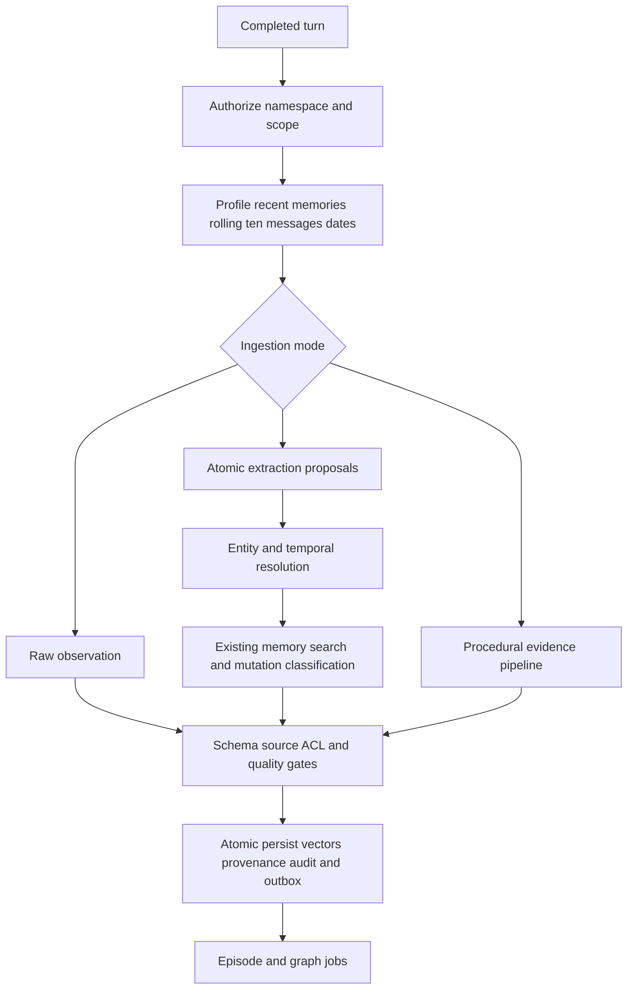
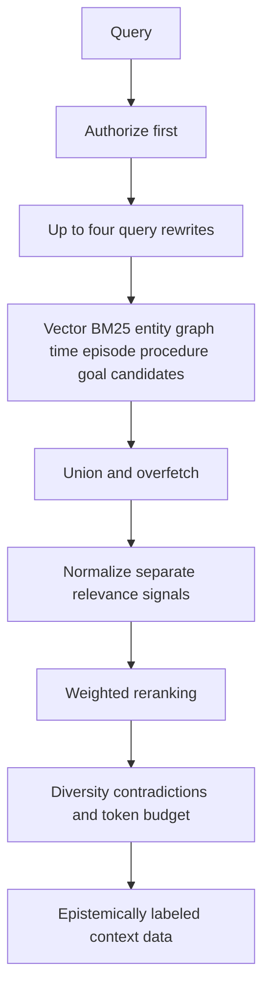
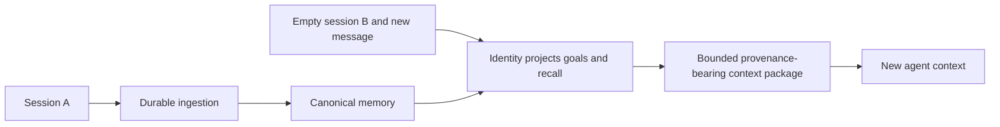
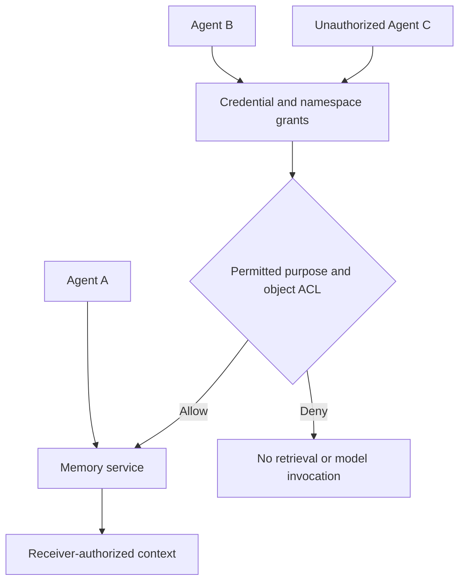
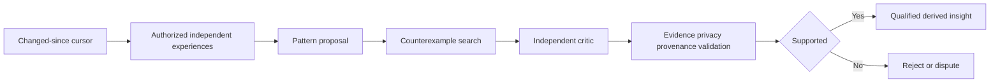
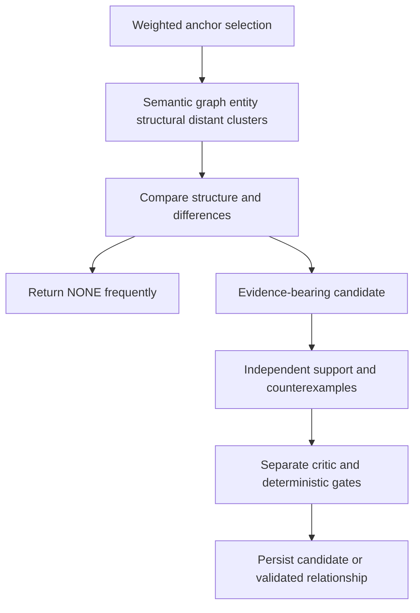
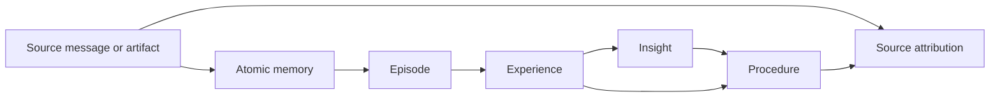
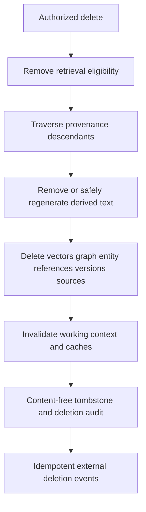
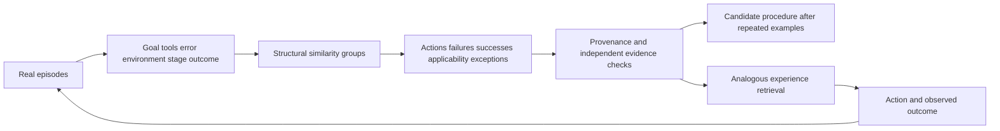

# Memory system flows

The complete system diagram is in `architecture.md`. These diagrams define the target architecture; the phase ledger distinguishes implemented behavior.

## Ingestion

## Retrieval

## Cross-session transfer

## Cross-agent transfer

## Reflection

## Serendipity

## Provenance

## Deletion cascade

## Experience compilation

